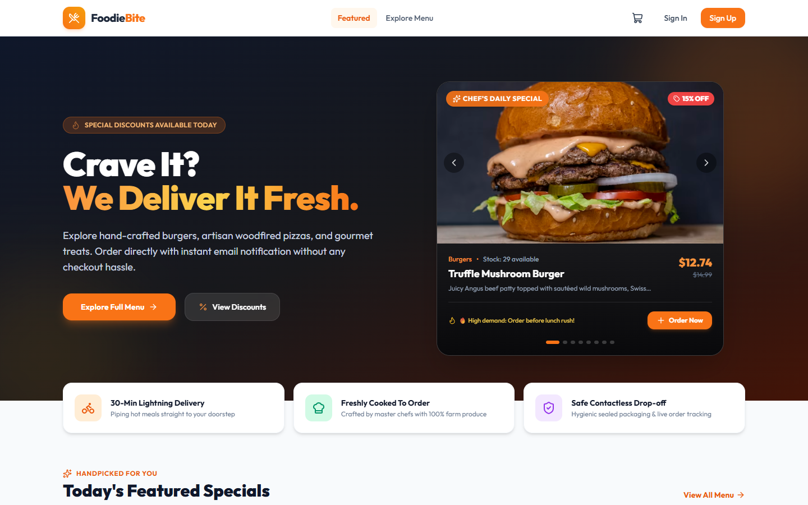
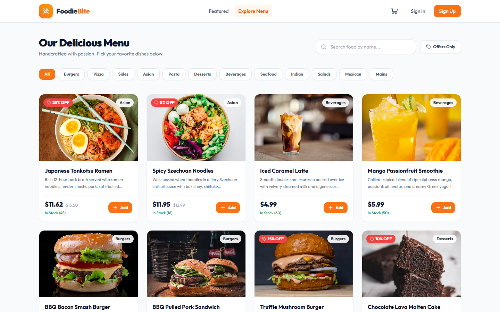
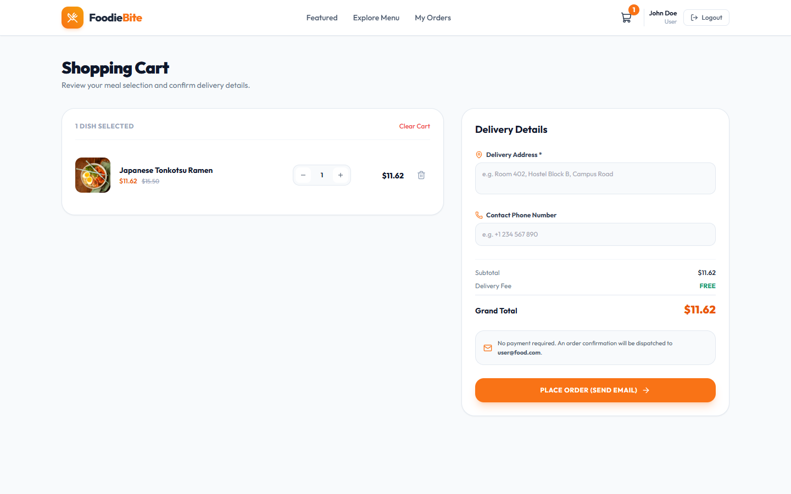
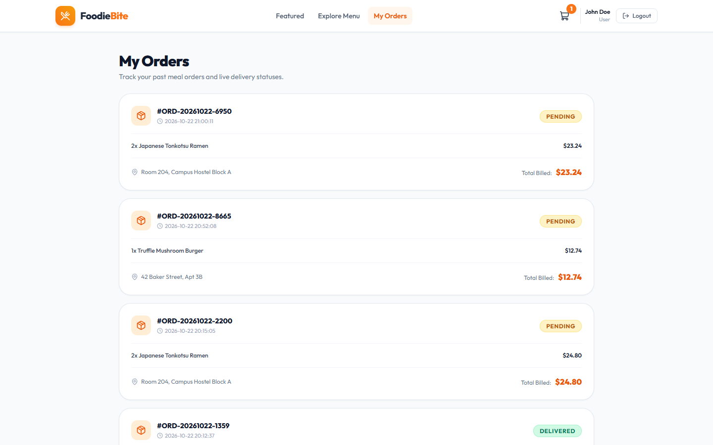
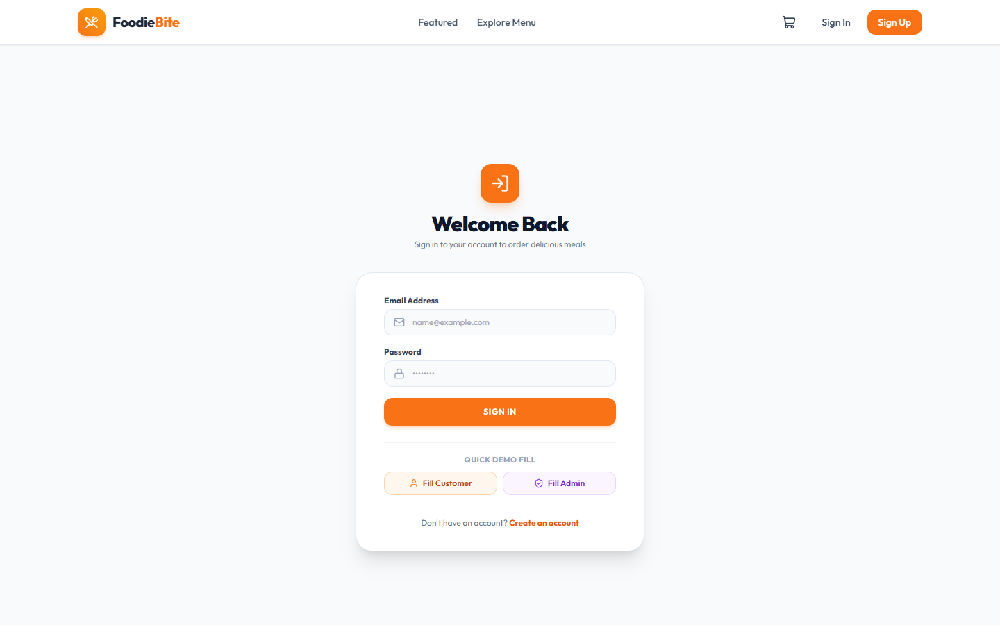
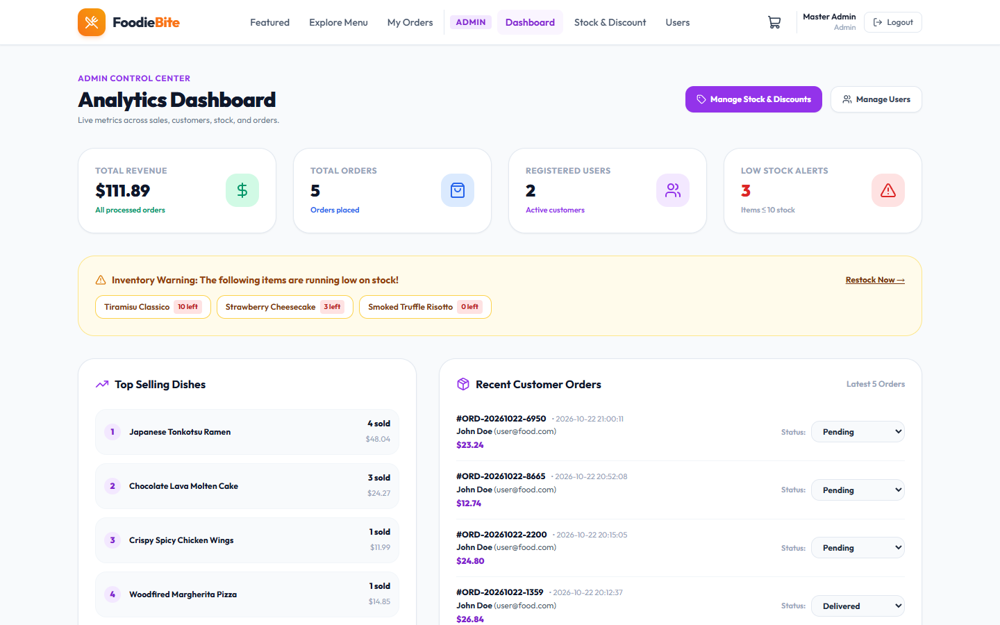
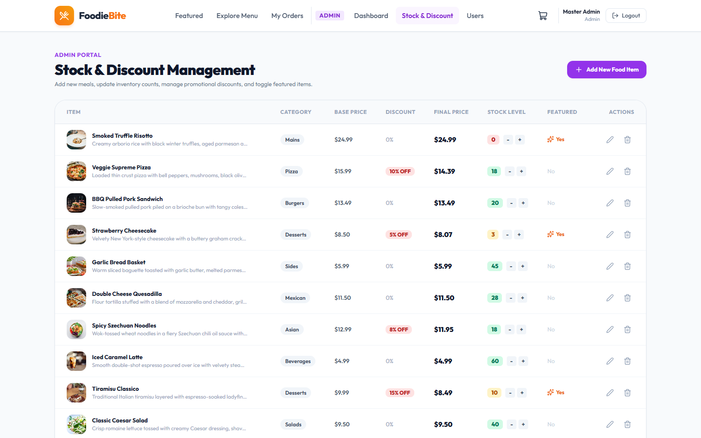

# 🍔 FoodieBite — Online Food Ordering Platform

A clean, modern, full-stack food ordering web application built with React, Tailwind CSS, Python Flask, and MySQL.

---

## 🚀 Tech Stack

- **Frontend**: React (Vite) + **Tailwind CSS v3** + React Router + Lucide Icons + Axios
- **Backend**: Python Flask + Flask-SQLAlchemy + PyMySQL + PyJWT + bcrypt + smtplib
- **Database**: MySQL (`food_ordering_db`)
- **Authentication**: JWT (JSON Web Tokens) with secure bcrypt password hashing
- **Notifications**: Automated order confirmation email delivery via Google SMTP (no payment required)

---

## 📁 Folder Structure

```
food-ordering-app/
├── backend/
│   ├── .env.example          # Sample environment config (copy to .env and fill in your values)
│   ├── config.py             # Configuration loader with single-line comments
│   ├── models.py             # SQLAlchemy models (User, FoodItem, CartItem, Order, OrderItem)
│   ├── app.py                # Main Flask application & auto-seed
│   ├── database.sql          # Complete MySQL schema & data population script
│   ├── requirements.txt      # Python dependencies
│   ├── test_api.py           # End-to-end integration test script
│   ├── utils/
│   │   ├── auth.py           # JWT generation, verification, and bcrypt hashing
│   │   └── mailer.py         # Order confirmation email notification utility (Google SMTP)
│   └── routes/
│       ├── auth_routes.py    # Login, register, profile
│       ├── food_routes.py    # Menu, featured items, categories
│       ├── cart_routes.py    # Cart CRUD actions & stock checks
│       ├── order_routes.py   # Order placement, real-time stock deduction, order history
│       └── admin_routes.py   # Analytics, stock & discount management, user management
│
└── frontend/
    ├── .env.example          # Sample frontend config (copy to .env)
    ├── package.json          # Node dependencies
    ├── tailwind.config.js    # Tailwind CSS v3 configuration
    ├── postcss.config.js     # PostCSS configuration
    ├── index.html            # Main HTML with Outfit Google font
    └── src/
        ├── api.js            # Axios client with JWT interceptor
        ├── main.jsx          # React DOM entry
        ├── App.jsx           # Routing & protected routes
        ├── index.css         # Tailwind CSS directives
        ├── context/
        │   ├── AuthContext.jsx # Global user auth & JWT token state
        │   └── CartContext.jsx # Global shopping cart state
        ├── components/
        │   ├── Navbar.jsx    # Responsive header with cart counter & admin navigation
        │   └── FoodCard.jsx  # Card with image, discount badge, stock status & out-of-stock overlay
        └── pages/
            ├── Featured.jsx  # Hero interactive carousel, demand urgency & delivery highlights
            ├── Menu.jsx      # Menu browsing, search, and category filters
            ├── Cart.jsx      # Cart review, delivery address, place order
            ├── Orders.jsx    # Past orders & live delivery status tracking
            ├── Login.jsx     # Login with 1-click Demo filler buttons
            ├── Register.jsx  # Customer & Admin sign-up
            └── admin/
                ├── AdminDashboard.jsx  # Business analytics, sales, top items, orders
                ├── StockManagement.jsx # Inventory stock & discount % manager
                └── UserManagement.jsx  # User account oversight & active/deactivate toggle
```

---

## 📋 Prerequisites

Make sure the following are installed on your system before running the application:

| Tool | Version | Purpose |
|------|---------|---------|
| **Python** | 3.8+ | Backend server runtime |
| **pip** | Latest | Python package manager |
| **Node.js** | 18+ | Frontend build & dev server |
| **npm** | 9+ | Node package manager |
| **MySQL** | 8.0+ | Database server |

---

## 🗄️ Database Setup & Population (`database.sql`)

The repository includes a complete SQL file: **`backend/database.sql`**.

This file automatically:
1. Creates the `food_ordering_db` database.
2. Creates all tables (`users`, `food_items`, `cart_items`, `orders`, `order_items`) with foreign keys and cascade rules.
3. Inserts initial users with bcrypt-hashed passwords.
4. Populates **22 gourmet food items** across 8 categories with high-res food photos, prices, discounts, and inventory counts.
5. Populates sample orders and order items so the Admin Analytics Dashboard displays live sales metrics immediately.

### How to Run `database.sql`:
```bash
cd backend
mysql -u root -p < database.sql
```
*(Enter your MySQL root password when prompted)*

---

## 🔑 Default Login Credentials

| Role | Email | Password | Access & Features |
|------|-------|----------|-------------------|
| **Admin** | `admin@food.com` | `admin123` | Full access to Admin Portal, Stock Management, Discounts, Analytics & User Management |
| **Customer** | `user@food.com` | `user123` | Browse menu, interactive hero carousel, add to cart, and place orders with email receipts |

> 💡 **Tip**: On the **Sign In** page, click the **"Fill Customer"** or **"Fill Admin"** button for instant one-click login!

---

## 📧 Email Notification Setup (Google SMTP)

When a customer places an order, an itemized order receipt is dispatched directly to their registered email address using Google SMTP.

### How to Get Gmail App Password:

1. Go to your Google Account: [https://myaccount.google.com](https://myaccount.google.com)
2. Navigate to **Security** (left sidebar).
3. Under **"How you sign in to Google"**, make sure **2-Step Verification** is turned **ON**.
   - If it's off, click on it and follow the steps to enable it first.
4. Once 2-Step Verification is enabled, go to: [https://myaccount.google.com/apppasswords](https://myaccount.google.com/apppasswords)
5. In the **"App name"** field, type `FoodieBite` (or any name you prefer) and click **Create**.
6. Google will generate a **16-character app password** (e.g., `abcd efgh ijkl mnop`).
7. Copy that password (remove the spaces) and paste it as the `MAIL_PASSWORD` value in your `backend/.env` file.

### Configure in `.env`:

A sample environment file is already provided at `backend/.env.example`. Copy it and fill in your values:
```bash
cd backend
cp .env.example .env
```

Then open `backend/.env` and update the email fields:
```env
MAIL_USERNAME=your_gmail@gmail.com
MAIL_PASSWORD=abcdefghijklmnop
MAIL_DEFAULT_SENDER=your_gmail@gmail.com
```

> ⚠️ **Important**: Use the 16-character **App Password** from Step 6 above, NOT your regular Gmail password. Regular passwords will not work with SMTP.

---

## ⚙️ How to Run the Application

### 1. Set Up Environment Variables
Copy the example environment files and fill in your credentials:
```bash
cd backend
cp .env.example .env

cd ../frontend
cp .env.example .env
```
Open `backend/.env` and replace the placeholder values with your MySQL password, JWT secret, and Gmail App Password.

### 2. Start the Flask Backend (Port 5000)
```bash
cd backend
python -m pip install -r requirements.txt
python app.py
```

### 3. Start the React Frontend (Port 5173)
```bash
cd frontend
npm install
npm run dev
```
Open **http://localhost:5173** in your browser.

---

## 📦 Features Summary

### 👤 User Portal
1. **Interactive Hero Carousel**: Auto-advancing showcase of daily featured specials with urgency indicators (*"Selling Fast! Only X Left"*), direct one-click ordering, and price tags.
2. **Food-Delivery Highlights**: Quick highlights for 30-min delivery, freshly prepared food, and contactless drop-off.
3. **Explore Menu**: Filter dishes across 8 categories (*Burgers, Pizza, Sides, Asian, Pasta, Seafood, Indian, Desserts, Beverages*), real-time name/description search, and "Offers Only" discount filter.
4. **Out-of-Stock Protection**:
   - Out-of-stock dishes display a prominent `"Out of Stock"` overlay.
   - The `"Add to Cart"` and `"Order Now"` buttons are disabled with `cursor-not-allowed`.
   - Backend APIs reject quantities exceeding available stock (`400 Bad Request`).
   - Placing an order automatically deducts inventory in real-time.
5. **Shopping Cart & Checkout (No Payment)**: Review items, adjust quantities, see original vs. discounted totals, enter delivery address & phone; an instant email confirmation is dispatched upon order creation.
6. **My Orders**: View previous orders, itemized receipts, and delivery statuses (*Pending, Preparing, Out for Delivery, Delivered*).

### 🛡️ Admin Portal
1. **Analytics Dashboard**: Live overview of Total Revenue, Total Orders, Registered Users, Low Stock Warnings, Top Selling Dishes, and Recent Orders.
2. **Stock & Discount Management**:
   - Add new food items with name, category, price, discount percentage, stock, and image URL.
   - Quick inline stock increment/decrement buttons (`+5`, `-5`).
   - Edit pricing, discounts, and toggle "Featured" status.
   - Delete items from the menu.
3. **User Management**: View all registered accounts, see roles (*Customer* vs. *Admin*), and toggle account active/deactivated status.
4. **Order Status Controls**: Change order statuses in real-time (*Pending* &rarr; *Preparing* &rarr; *Out for Delivery* &rarr; *Delivered*).

---

## 🧪 Automated Testing
Run the included integration test suite:
```bash
cd backend
python test_api.py
```

---

## 📸 Application Screenshots

### 1. Home / Featured Showcase
Auto-advancing hero carousel with dynamic urgency stock badges, fast order buttons, and culinary highlights.


### 2. Menu Catalog & Category Filters
Interactive dish browsing with category pills, live keyword search, discount tags, and out-of-stock indicators.


### 3. Shopping Cart & Checkout
Review dishes, adjust quantities, see price breakdowns with discounts, and place orders with instant email confirmation.


### 4. Customer Order History
Real-time tracking of past orders with itemized breakdowns and live delivery statuses (*Pending*, *Preparing*, *Delivered*).


### 5. Secure Authentication
JWT-based login and registration for customers and administrators.


### 6. Admin Analytics Dashboard
Real-time KPI metrics, revenue, total orders, customer accounts, and low-stock inventory alerts.


### 7. Admin Inventory & Stock Control
Inline stock updates (`+5` / `-5`), discount management, featured dish toggles, and new dish creation.


